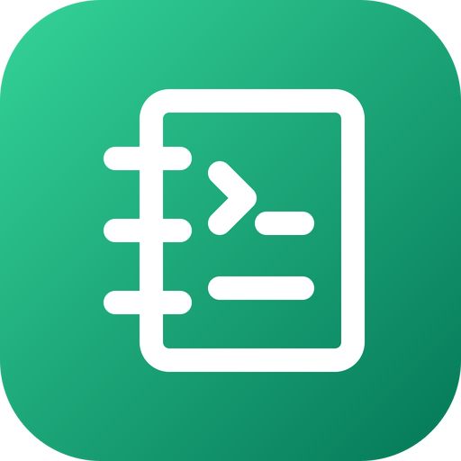

# go-notebook — brand assets

Official logos for the **go-notebook** organization.

The mark is a notebook with two cells, a prompt and a line of code, in the
emerald gradient (`#34D399` to `#047857`) that go-notebook shares with its
scientific-computing siblings go-ndarray and go-fft.

## Formats

- **SVG** — `svg/color`, `svg/white` (white, transparent), `svg/black` (black, transparent)
- **PNG** 16→1024 px, 3 variants — `png/<variant>/<size>/`
- **JPG** (color, white background) — `jpg/<size>/`
- **ICO** (Windows) — `ico/`
- **ICNS** (macOS) — `icns/`
- **GitHub avatar** 512 px — `avatar/`
- **Social preview** 1280×640 (repo banner) — `social/`

`check/kit.py` counts the whole matrix on every pull request.

---
*Generated from `svg/color/go-notebook.svg` by the fleet's Go brand pipeline (brandgen) — rounded square badge, line glyph, color / white / black variants.*
